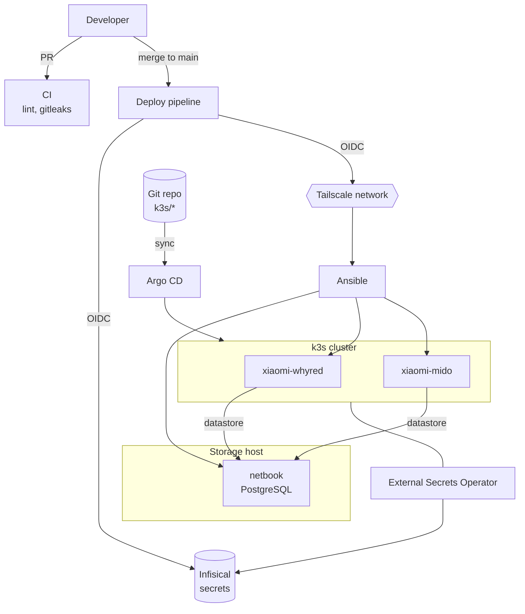

# redmilab

A personal homelab that runs a **Kubernetes (k3s) cluster on two repurposed smartphones**, backed by a PostgreSQL datastore on an old netbook. Everything is managed as code: Ansible configures the machines and bootstraps the cluster, then Argo CD takes over, and a GitHub Actions deploy pipeline is the only path to production.

Built for learning GitOps, Kubernetes, Linux, and networking, under one constraint: **zero budget**.

## Overview

- **Kubernetes on phones.** A 2-node k3s cluster on postmarketOS (Alpine-based), using an external PostgreSQL datastore so the control plane is decoupled from the cluster nodes.
- **GitOps.** Argo CD syncs the cluster from this repo. Adding a folder under `k3s/` deploys a new application.
- **Tailscale-first networking.** No public inbound and no static IPs. SSH, deployments, and cluster traffic all run over a Tailscale network.
- **Automated deployments.** Every change goes through the deploy pipeline on merge to `main`, with no manual SSH changes. Pull requests are checked by a separate CI pipeline.
- **Centralised secrets.** Infisical is the single source of truth for secrets, used by both the deploy pipeline and Kubernetes. The pipeline authenticates via OIDC, so no long-lived credentials are stored in GitHub, and External Secrets Operator syncs secrets into the cluster.
- **Hardware tuning.** Device-tree changes were made to limit battery voltage and power consumption has been reduced.

## Architecture

## Hardware

| Host | Device | Role | OS |
|---|---|---|---|
| `xiaomi-whyred` | Redmi Note 5 (Snapdragon 636), 4 GB RAM | k3s node | postmarketOS |
| `xiaomi-mido` | Redmi Note 4X (Snapdragon 625), 4 GB RAM | k3s node | postmarketOS |
| `netbook` | ASUS Eee PC (Intel Atom), 2 GB RAM, 256 GB SSD | PostgreSQL datastore | Alpine Linux |

## Networking

All machines join a Tailscale network. Ansible, the deploy pipeline, and cluster networking use it, and in-cluster services are exposed to it through the Tailscale Kubernetes operator rather than to the internet.

## Ansible

Ansible configures the machines (packages, DNS, firewall, services, device-specific fixes) and builds the k3s cluster on top of them. Its job ends once the cluster is up and Argo CD is installed and pointed at this repo. From there, GitOps takes over.

## GitOps

Argo CD manages everything in `k3s/`, including itself. Current workloads:

- **Argo CD**: the GitOps controller and the ApplicationSet that deploys the rest
- **External Secrets Operator**: syncs secrets from Infisical into the cluster
- **Tailscale operator**: Tailscale network ingress and service exposure
- **AdGuard Home**: network-wide DNS filtering

## Secrets management

Infisical is the single source of truth for secrets, used for both the deploy pipeline and Kubernetes. The deploy pipeline fetches secrets at run time via OIDC, and the External Secrets Operator syncs them into the cluster. Nothing sensitive is committed, and gitleaks scans the full history on every pull request.

## Pipelines

- **CI** (on pull requests): lint and gitleaks.
- **Deploy** (on merge to `main`): joins the Tailscale network, fetches secrets from Infisical, and runs the Ansible playbook.

## Roadmap

- [ ] **Backups** of the k3s database and other important files
- [ ] **File sharing** (Syncthing, NFS, or similar)
- [ ] **Media streaming** with Jellyfin or Navidrome
- [ ] **Monitoring** with Prometheus and Grafana
- [ ] **AI-assisted monitoring** with Hermes